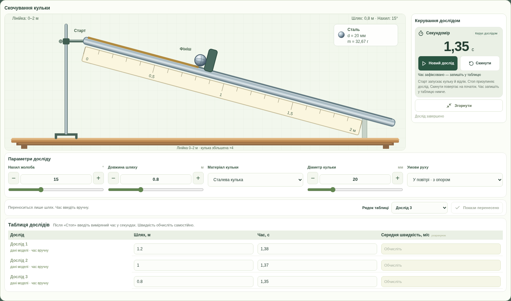

# Секундомір і спільне робоче поле дослідів

У роботах **№1–3** є єдиний блок керування рухом — ручний секундомір праворуч від установки. Він доступний у скочуванні кульки, рівномірному обертанні та всіх трьох серіях нитяного маятника (амплітуда, довжина, маса). Окремих дубльованих кнопок запуску й скидання немає.

У роботах №4–10 вимірюють масу, розміри, сили, тиск, густину та умови плавання; вимірювання часу не входить у таблиці. Там залишаються звичайні запуск, пауза та скидання. Коротка анімація показує зміну стану, а не виміряний учнем час.

- **Старт** одночасно запускає відлік і рух установки.
- **Стоп** призупиняє відлік і рух, до завершення заданого шляху або кількості циклів.
- **Продовжити** відновлює їх із того самого моменту.
- **Скинути** обнуляє секундомір і повертає установку на початок.
- **Новий дослід** після фінішу та зупинки починає новий запуск із нуля. Перед натисканням перепишіть попередній час у таблицю.

На фініші кулька зупиняється біля упору; у роботах №2–3 рух завершується після заданої кількості повних обертів або коливань. Секундомір продовжує відлік до ручного натискання **Стоп**. Учень фіксує момент завершення самостійно. Випадкова похибка не додається; затримка реакції учня є частиною ручного вимірювання.

Рух усіх трьох установок обчислюється за тим самим монотонним часом, що й секундомір: масштаб 1× зберігається також після паузи, розгортання та згортання. Налаштування зменшення анімацій більше не перескакує відразу до фінішу в роботах №1–3. Відображення сотих часток секунди — роздільність показів, а не гарантована точність вимірювання.

Поки секундомір працює, параметри установки та перенесення показів заблоковані. Після **Стоп** можна змінити параметри — це готує новий запуск і повертає секундомір та установку на початок. Введені в таблицю відповіді зберігаються до явної зміни учнем.

## Таблиця під установкою

У всіх десяти роботах під установкою розташовано блок **Параметри досліду**. У першій це нахил, шлях, матеріал, діаметр кульки й умови руху; у решті — відповідні параметри їхніх приладів. У широкому вікні налаштування розкладені в ряд, на вузькому екрані переносяться. Внутрішнього вузького прокручування параметрів немає. Праворуч від установки залишаються секундомір (№1–3) або кнопки приладу (№4–10), стан досліду та розгортання/згортання.

Далі розташовані вибір рядка й перенесення показів, а потім повна таблиця дослідів із полями поточної роботи. В усіх серіях збережені назви рядків, одиниці, підказки до обчислень та перевірка відповідей у навчальному режимі. У розгорнутому вікні вона доступна для введення без виходу з досліду; після згортання ті самі значення залишаються в зошиті. На телефоні таблиця має власне горизонтальне прокручування. У звичайному вигляді згортання блоку віртуальної лабораторії не приховує таблицю.

У роботі №1 таблиця розташована в тому самому блоці відразу після параметрів і перенесення показів. Великий дубльований блок характеристик кульки прибрано. Після згортання віртуальної лабораторії таблиця залишається доступною окремо; введені значення зберігаються. У правій колонці замість картки маршруту показано формулу **vсер = l / t**, позначення величин та одиниці м, с і м/с. Компактні відомості на рисунку установки та фізична модель залишаються доступними.

Кнопка **Перенести покази в таблицю** у №1 переносить тільки шлях, у №2 — кількість обертів, у №3 — умови та кількість коливань. Попередні розрахунки цього рядка очищуються. Час залишається порожнім або зберігає вже введене значення. Його потрібно переписати із секундоміра самостійно. Учень сам обчислює швидкість, період і частоту відповідно до роботи.

Установка має адаптивний рисунок на всю ширину поля: стіл заповнює сцену, а жолоб, шкала й кулька масштабуються рівномірно, щоб не спотворювати кут нахилу та круглу форму кульки. При зміні розміру вікна або умов досліду масштаб вигляду підбирається автоматично; довжина лінійки залишається 2 м. Компактні параметри, перенесення показів і таблиця дають змогу бачити всі три рядки в розгорнутому вікні 1920×900 при масштабі браузера 100%. На телефоні доступне звичайне прокручування та великі поля введення.

Довідковий модельний час залишається окремим показом моделі та частиною збереженого джерела синтетичних даних. Він не підміняє ручне вимірювання. У PDF та друці використовується введений учнем час в основній таблиці. Раніше збережені відповіді та джерела не змінюються.

Калькулятор залишається в інструментах дослідника. Нова міграція бази або нові залежності для цієї функції не потрібні.
